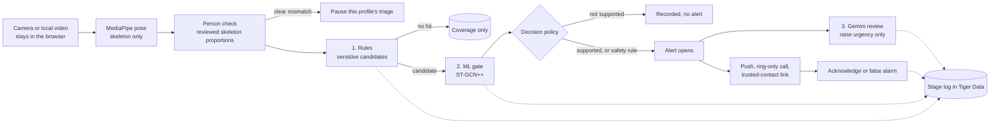

<p align="center">
  
</p>

<h3 align="center">Privacy-first movement monitoring that tells a care team about a fall, and the unsteadiness before it, with the evidence to act. No video leaves the room.</h3>

Hayvn turns camera or local-video frames into a stick-figure skeleton in the browser, and only that skeleton is sent to the server. A reviewed, per-profile body-shape check pauses clear mismatches. Then rules, a learned action model, and Gemini assess movement and decide whether to alert someone. Every alert carries the evidence behind it and stays open until a human acknowledges it.

> Hayvn is an engineering prototype. It is not a medical device or an emergency service, and it makes no clinical claims.

## Why Hayvn

In nursing homes and senior living, small signs of unsteadiness usually come before a fall, and staff cannot watch every room. Cameras raise privacy problems. Plain motion alerts cry wolf until people stop listening. Hayvn is built around those three constraints:

- **Privacy by construction.** Pose extraction runs in the browser. Raw video is never uploaded, and per-profile deletion removes stored data.
- **Fewer false alarms.** A sensitive rule only creates a *candidate*. A pretrained skeleton-action model has to support it before it becomes an alert.
- **AI that can only escalate.** Gemini adds context and a plain-language explanation. It can raise an alert's urgency and can never lower it, and an AI failure never silences an alert.
- **A closed loop.** Alerts notify by push and an optional ring-only phone call, escalate until someone acknowledges, and log every stage for review.

## Built for Hack the Valley 11

| Prize | How Hayvn fits |
| --- | --- |
| **PointClickCare: Catch It Early** | Risk: falls and the unsteadiness before them. User: the care team (nurse, CNA, wellness director). AI: ST-GCN++ gate plus Gemini review. Every alert explains why it fired. |
| **Healthcare & Well-being** | Passive safety for people who cannot always ask for help, framed as support for a human check, never as diagnosis. |
| **AI for Social Impact** | Ethical design (consent, deletion, no diagnostic language), transparency (visible triage stages, cited evidence, audit trail) and measured results with stated limits (see [Evidence](#evidence-and-honest-limits)). |
| **Best Use of Gemini API** | Schema-validated contextual review of already-supported alerts. See [Gemini](#gemini). |
| **Best Use of Tiger Data** | Time-series stage log, hypertables and continuous aggregates behind an activity API. See [Tiger Data](#tiger-data). |
| **Best Use of Vultr** | Three-node deployment (app, rules, ML) with Docker Compose files per node. See [Vultr](#vultr). |

Where each of these stands today (built, tested, deployed, or still to verify) is stated plainly in [Evidence and honest limits](#evidence-and-honest-limits).

## How it works



**Capture.** MediaPipe Pose Landmarker runs in a Web Worker. Landmarks are smoothed, and tracking dropouts under half a second are bridged with the last good pose. Exactly one visible person is scored; a second person makes the frame uncertain and pauses scoring.

**Person check.** The operator records ordinary movement in two capture sessions and confirms it belongs to the profile before fitting. The app stores median upright skeleton proportions for shoulders, hips, arms and legs. Each stream must provide several consistent readings before rules start. Several large, persistent differences pause its rules and exclude those frames from daily baseline learning. A match means the pose is consistent with the reviewed reference; similar-looking people and poor camera angles cannot be reliably distinguished. Older profiles need new reviewed calibration before this check and automatic learning are active.

**1. Rules** ([`detector.py`](backend/app/detector.py)). Two-second windows are scored about three times a second. Rules are tuned for recall because later stages filter them: a possible *fall* (lying outside the bed zone after a hip drop above 0.35 torso lengths, or upright then lying within 3.5 seconds), *prolonged stillness* on the floor (30 seconds, urgent at 120), *stumble*, sustained *sway*, and contextual *restricted-hours standing* and *bed exit*. Each hit becomes a durable, idempotent candidate record.

**2. ML gate** ([`action_model.py`](backend/app/action_model.py), [`ml_api.py`](backend/app/ml_api.py)). The official ST-GCN++ NTU60 2D checkpoint (1,393,016 parameters, pinned SHA-256, CPU only) scores the same two-second skeleton. Fall candidates need a falling-class score of at least 0.25; stumble and sway candidates need a staggering-class score of at least 0.1. These are softmax scores, not probabilities of harm.

**Decision policy** ([`decision.py`](backend/app/decision.py), version `rules-ml-gemini-v1`):

| Situation | Outcome |
| --- | --- |
| ML supports the fall, stumble or sway rule | Alert opens immediately, notifications queue, Gemini reviews |
| ML does not support it | Candidate recorded for later review, no alert |
| Prolonged stillness on the floor | Safety rule alerts even if the ML rejected the drop |
| ML unavailable or uncertain, and the rule's urgency floor is Concern or higher (fall, stillness, bed exit) | Safety fallback alerts; triage progress marks it as a safety-rule alert |
| Restricted-hours standing | Rule alert, ML skipped (a contextual rule, not a movement class) |
| Bed exit or personal-baseline hit while the model is working | Held: recorded in the stage log, no alert in the default mode |

**3. Gemini** ([`gemini.py`](backend/app/gemini.py)) reviews alerts after they open. A failed, slow or invalid review leaves the alert in place with a fallback status and the specific reason.

**Notify and close the loop** ([`notifications.py`](backend/app/notifications.py)). Web push and an optional ring-only phone call go to the profile's contacts. Unacknowledged alerts keep re-notifying. Acknowledging cancels pending sends. **False alarm** dismisses the alert and logs a human review.

## What a care team sees

- **Two modes.** *Care* opens a set of profile cards before capture; each has a grey default avatar. *Personal* is for one person, with an optional on-screen check-in before anyone is contacted.
- **Triage progress** on every capture and alert shows the person check, Rules, ML and Gemini, including paused or skipped stages.
- **Evidence with each alert:** the rule that fired, measured posture, trunk angle, visibility, the personal-baseline change score (when scored), the ML scores, and Gemini's summary when it ran.
- **Acknowledge or False alarm** from the alert, or from a signed trusted-contact link that works without logging in (scoped to one event and one contact, expires after seven days).
- **Per-profile privacy panel:** consent state, stored-row counts, pause, and permanent deletion with a receipt.

## Safety and privacy by design

- Raw video never reaches the API. The server stores skeleton landmarks (identifying movement data), which are removed by per-profile deletion.
- Gemini receives profile context without alias or contact details, detector metrics, ML scores and three skeleton drawings (320 by 240 images drawn from landmarks, not camera pixels). It runs only when the profile has consented and a billed Gemini project is confirmed; otherwise the alert still goes out.
- Gemini output is untrusted until validated: strict JSON schema, every evidence item must cite data that was actually sent, diagnostic language is rejected, and the final urgency is `max(deterministic floor, proposed urgency)`. Proposed versus applied urgency is audited.
- Gemini is limited to one review per uploaded video, and alerts are deduplicated per rule within a five-second window.
- Notification IDs are idempotent. Calls fire once per event, with a cooldown and daily limit, to an allowlisted number only. Provider delivery is at-least-once.
- Production refuses to start without PostgreSQL, 32+ character secrets and an HTTPS `PUBLIC_URL` (plus a unique 32+ character internal token when the services are split). Sessions use signed cookies, state-changing requests and the pose WebSocket are origin-checked, requests are size-limited, and login is rate-limited.
- A personal statistical baseline (per-posture median/MAD) updates daily from normal activity that passed the person check (80% previous, 20% new day), then deletes the processed pose windows. See [BASELINE.md](docs/BASELINE.md).

## Architecture and stack

| Layer | Technology | Where |
| --- | --- | --- |
| Capture and UI | React 19, TypeScript, Vite, MediaPipe Tasks Vision in a Web Worker, service worker for push | [`web/src`](web/src) |
| App service | FastAPI, SQLAlchemy 2, WebSocket pose ingest, decision policy, notifications | [`backend/app`](backend/app) |
| Rules service | The detector as its own FastAPI service (`:8001`) | [`rules_api.py`](backend/app/rules_api.py) |
| ML service | ST-GCN++ inference as its own service (`:8002`) | [`ml_api.py`](backend/app/ml_api.py), [`vendor/stgcn`](backend/app/vendor/stgcn) |
| Data | SQLite locally, PostgreSQL / Tiger Data in production, same models | [`db.py`](backend/app/db.py), [`deploy/tiger.sql`](deploy/tiger.sql) |
| AI | Gemini REST (structured JSON output), ST-GCN++ on CPU | [`gemini.py`](backend/app/gemini.py) |
| Delivery | Web Push (VAPID), Twilio Voice (ring-only, inline TwiML, no speech or recording) | [`notifications.py`](backend/app/notifications.py) |
| Deploy | Docker, Compose per node, Caddy for TLS and WebSockets | [`compose.*.yaml`](compose.yaml), [`deploy`](deploy) |

The rules and ML services require an `X-Internal-Token`, echo a correlation ID that the app checks, and bind to a private IP. The app is the only service that holds profiles, consent, the database, Gemini credentials and notification work, and it runs a single worker so alerts are never reviewed or delivered twice. `openapi.json` is generated from FastAPI and drives `web/src/api-types.ts`.

## Sponsor technology

### Gemini

Gemini is the third stage, not a gate. For an alert the ML supported (or a safety-rule alert), the app sends profile context, metrics, ML evidence, recent events and skeleton keyframes, and asks for a structured verdict: a verdict label, urgency, confidence, summary, cited evidence, profile factors and recommended actions. Responses are validated as described above; on any failure the alert keeps its deterministic urgency and shows why the review failed (timeout, HTTP error, schema mismatch). The model is configurable (`GEMINI_MODEL`); thinking is set low so a review fits its timeout.

### Tiger Data

Tiger Data holds Hayvn's time series. [`deploy/tiger.sql`](deploy/tiger.sql) defines three hypertables and three continuous aggregates:

- `event_stage_log`: an append-only record of every incident's path (candidate, ML result, decision, Gemini result, incident opened, notification, acknowledgement).
- `pose_windows` and `monitoring_coverage`: scored movement windows, plus an hourly coverage summary that survives the daily purge.
- `hourly_incidents`, `hourly_movement`, `daily_baseline`: continuous aggregates for incident counts, movement trends and the personal baseline.

The Activity API ([`activity.py`](backend/app/activity.py)) returns a bounded incident timeline, a seven-day by 24-hour grid of *incident openings* (kept separate from monitoring coverage so "nothing happened" is never confused with "camera was offline"), and per-cell drill-down. On PostgreSQL it reads completed hours from `hourly_incidents` and the current hour from raw rows. `python -m scripts.migrate_tiger` is a read-only preflight; `--apply` is idempotent.

### Vultr

The same repository runs as one role per node: [`compose.app.yaml`](compose.app.yaml) (UI, API, Gemini, notifications, Tiger connection), [`compose.rules.yaml`](compose.rules.yaml) and [`compose.ml.yaml`](compose.ml.yaml) (CPU PyTorch, no database or Gemini credentials). Rules and ML ports publish only on the node's private VPC address. [`compose.yaml`](compose.yaml) runs all three roles on one machine for local rehearsal. See [THREE_STAGE_DEMO.md](docs/THREE_STAGE_DEMO.md).

## Run it

Requires Python 3.11+ and Node 20.19+ (Node 24 recommended).

```powershell
python scripts/dev.py --with-action-model --build
```

The launcher creates the virtual environment, installs dependencies (CPU PyTorch and the verified ST-GCN++ checkpoint with `--with-action-model`), builds the UI and serves **http://localhost:8000**. Sign in with the local development token `local-demo-only`, create a Care or Personal profile, then start the camera or upload a video. Later launches can use `python scripts/dev.py`.

Without `--with-action-model` the app still runs, but the ML gate is unavailable, so only the fall and stillness safety rules can raise alerts. Everything runs locally with no credentials: SQLite for data, `dry_run` notifications, Gemini off. To enable integrations, copy `.env.example` to `.env` and follow [SETUP.md](docs/SETUP.md).

Key switches: `DECISION_MODE` (`enforce` default, or `shadow`), `FALL_SCORE_THRESHOLD`, `GEMINI_API_KEY` with `GEMINI_BILLED_PROJECT_CONFIRMED`, `DATABASE_URL`, `NOTIFICATION_MODE` and `CALLS_ENABLED`.

```powershell
.\.venv\Scripts\python.exe -m pytest backend/tests -q
.\.venv\Scripts\python.exe -m scripts.evaluate_replays   # rewrites docs/replay-results.json
npm.cmd --prefix web run build
```

On macOS or Linux use `.venv/bin/python` and `npm`.

## Four-minute demo

1. Create or select a consenting profile and choose **Upload demo video** (or **Start camera**). Use a pre-approved staged clip; nobody should perform a dangerous fall. No clip is bundled in the repository.
2. Accept consent. Playback waits for the pose worker, then overlays the one visible person's skeleton. The video file never leaves the device.
3. Watch **Triage progress** move through Rules, ML and Gemini. At the end the UI shows one of: an alert, a held or uncertain candidate, no alert, or no usable pose.
4. Open **Alerts**: the evidence, Gemini's summary, who was notified and in what state. Acknowledge, or mark **False alarm**.
5. Show the privacy panel and its deletion receipt, using a disposable profile.

The Alerts page loads saved events for the selected profile. Activity loads a seven-day by 24-hour heat map of incident openings and monitoring coverage from the API. Each hour can be opened to see its saved alerts (`/api/activity/{person_id}/heatmap` and `/cell`). The API is exercised by the test suite on SQLite; a live Tiger Data service has not been verified.

## Evidence and honest limits

| | |
| --- | --- |
| **Demonstrated** | 104 backend tests pass, covering rule scenarios, the ML gate and decision policy, incident grouping, Gemini validation and failure paths, consent and purge, notification idempotency and acknowledgement, and the activity queries. |
| **Measured, synthetic** | [`docs/replay-results.json`](docs/replay-results.json): a synthetic fall queued an alert 0.667 s after its scripted onset (ingest p95 about 9.5 ms); a nine-second normal fixture produced zero events. This excludes camera inference, network and provider delivery, and nine seconds is far too little to infer a false-alert rate. |
| **Measured, staged** | On two staged recordings the falling score was 0.72 (close) and 0.34 (far, partly tracked) against a 0.25 cutoff, and staged stumbles scored 0.06 to 0.25 on the staggering class against 0.00 to 0.02 for normal walking (cutoff 0.1). Two clips set the cutoffs; this is calibration, not validation. |
| **Simulated** | Synthetic profiles and replays, and `dry_run` notifications (shown as *simulated*). |
| **Not yet verified** | Gemini response quality and latency against a live billed project; a provisioned Tiger Data service (migration, aggregate refresh, query timings); a Vultr deployment; real push and phone delivery; accuracy on real falls; false alerts per monitored hour; the personal baseline on real data. |

Rule thresholds are starting heuristics. The pretrained model ranks 60 known actions and always picks one, so its scores are evidence for a policy, not calibrated probabilities. Walker detection, identity verification, IP cameras and clinical use are out of scope. An absent alert is never proof that someone is safe.

## AI tools, third-party work and provenance

**AI tools used to build Hayvn:** OpenAI Codex (application code, schemas and prompts) and Anthropic Claude via Claude Code (it co-authored 12 of this repository's 22 commits, per their trailers). **Used at runtime:** the Gemini API, as described above.

**Third-party components:**

- Google MediaPipe Pose Landmarker (Apache-2.0): the lite model is downloaded and the WASM runtime copied from the npm package by `npm run assets`.
- The ST-GCN++ inference subset from OpenMMLab MMAction2 v1.2.0 (Apache-2.0) and its official NTU60 2D joint checkpoint, fetched and SHA-256 verified by `scripts/setup_action_model.py`. Attribution is in [`NOTICE.md`](backend/app/vendor/stgcn/NOTICE.md). No NTU RGB+D recordings are used or redistributed.

**Provenance:** the idea and architecture were planned before the event. The repository's first commit is Fri Oct 16, 11:05 PM ET, and all code in this history was committed after it. The full commit history is in this repository.

## Repository map

| Path | Purpose |
| --- | --- |
| `backend/app` | API, rules, decision policy, Gemini, notifications, activity queries, persistence |
| `backend/tests` | 104 integration and failure-path tests |
| `web/src` | Capture, dashboard, alerts, profiles, trusted-contact view |
| `deploy` | Tiger Data SQL and the Caddy TLS proxy |
| `scripts` | Launcher, OpenAPI export, replay and baseline evaluation, Tiger migration |
| `docs` | [Setup](docs/SETUP.md), [three-stage demo and deployment](docs/THREE_STAGE_DEMO.md), [action model](docs/ACTION_MODEL.md), [baseline](docs/BASELINE.md), [verification record](docs/VERIFICATION.md) |

Built by David Druker.
