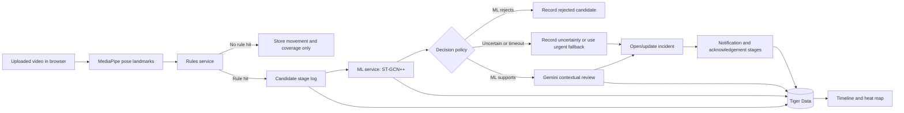

# Three-instance Vultr and Tiger Data implementation report

Prepared 17 October 2026. This report assumes the three Vultr instances, Tiger Data service, private connectivity, secrets, and Gemini access are already available. It describes only the code needed for the revised pipeline and Tiger Data experience.

## Scope and implementation decision

The current rules are deliberately sensitive and can produce false positives. The new pipeline treats a rule hit as a **candidate**, then asks the existing 1,393,016-parameter model for a movement verdict, then sends only supported candidates to Gemini for contextual review. The code must preserve an explicit high-urgency fallback when the ML service is unavailable or prolonged stillness is detected; otherwise an outage could silently discard a serious event.

The Tiger Data work must show two useful views of the same real event stream:

- a chronological timeline of when an event moved through rule, ML, Gemini, notification, and acknowledgement stages;
- a 7-day by 24-hour heat map of **incident openings**, separate from monitoring coverage and pose-window volume.

## Terms used in this report

| Term | Meaning in SilentGuardian |
| --- | --- |
| **Pose landmark** | One numbered body point from MediaPipe, such as a shoulder, hip, knee, or ankle. The browser extracts normalized x/y position and visibility from the uploaded video; the raw video stays in the browser. |
| **Pose frame** | All detected landmarks for one video moment, plus the timestamp, selected person, camera/session identifier, and tracking state. |
| **Rolling window** | A short, recent sequence of pose frames. The detector retains about two seconds of movement so it can compare current posture to earlier movement rather than judging one still image. |
| **Rule** | A hand-written, measurable condition in `backend/app/detector.py`. A rule is designed to notice suspicious motion quickly, even if it sometimes overreacts. |
| **Rule hit** | A rule that evaluated as true for a scored window. Examples include a rapid hip drop followed by lying outside the bed zone (`fall`), 30 seconds of stillness on the floor after a fall (`prolonged_stillness`), unusual standing sway, a stumble pattern, restricted night standing, or bed exit. A hit means “possible incident,” not “confirmed emergency.” |
| **Candidate** | The durable record created when one or more rule hits should be checked by the ML service. A candidate carries timestamps, the rule hits, derived metrics, profile version, and the minimal two-second skeleton sequence needed by the model. |
| **ML verdict** | The second-stage result from the existing ST-GCN++ action-recognition model. It returns scores for its learned movement classes, including falling and staggering, plus input quality, checkpoint identity, and latency. Its scores are evidence for a policy, not medical probabilities. |
| **Decision policy** | Versioned backend logic that combines rule evidence, ML result, model quality, timeouts, and urgent fallback conditions to decide whether to reject, hold, or send a candidate to Gemini. |
| **Gemini verdict** | Schema-validated contextual review of an already-supported candidate. Gemini receives limited event evidence and profile context only after the profile’s Gemini consent is present. It must not lower the deterministic urgency floor. |
| **Incident/event** | The user-visible alert record. One incident may have several rule hits and several timeline stages, but the heat map counts it once when it opens. |
| **Stage log** | An append-only Tiger time-series record showing when an incident passed each pipeline stage. It makes the new architecture visible and debuggable. |
| **Monitoring coverage** | Time in which the browser was actually sending usable pose data. It prevents a dark heat-map cell from being misread as “nothing happened” when monitoring was offline. |

## What happens today, and what changes

Today, the browser sends landmarks to one backend process. That process runs the fixed rules, opens an event immediately when a rule hits, queues notification work, and then Gemini may review the open event. The action model runs separately in shadow mode: it writes a prediction but cannot affect alerts or Gemini input.

The new code changes the meaning of the rule stage. A rule hit becomes a high-recall **candidate** rather than an automatic confirmation. The candidate is sent to the dedicated ML service. The decision policy then either rejects it as an expected movement, records it as uncertain for later review, forwards it to Gemini, or uses a documented urgent fallback.



## Current repository state

- The current `compose.yaml` and `Dockerfile` build one `guardian` FastAPI container with rules, CPU action model, Gemini, notifications, and the web UI. Caddy fronts that one service. There is no three-node deployment configuration.
- Browser MediaPipe produces landmarks. `backend/app/detector.py` scores approximately two-second windows about three times per second, and `backend/app/service.py` creates an event and queues notifications as soon as rules hit. Gemini scans pending events afterward.
- The official ST-GCN++ NTU60 2D checkpoint has **1,393,016 parameters**, but `backend/app/actions.py` runs it in **shadow** mode. Its scores cannot create, suppress, or escalate alerts, and `backend/app/gemini.py` excludes those scores from Gemini input. The classifier predicts among 60 actions; its fall score is not a calibrated probability of harm. There is no validated live gate today.
- Tiger support already includes a `pose_windows` hypertable and `hourly_movement` / `daily_baseline` continuous aggregates in `deploy/tiger.sql`. The `/api/trends/{person_id}` route currently reads retained raw windows into Python and calculates daily metrics there; it does not query those aggregates. The UI currently shows alert history as a list and has no schedule or heat map.
- `events` is a regular relational table. Its `opened_at` and `observed_at` can support an exact incident timeline, but a Tiger-powered event heat map needs a proper time-series event log or an intentional query design. Do not count every overlapping pose window as an incident.

## Target application flow

```text
Browser camera/local video (MediaPipe landmarks)
    -> HTTPS app ingress (auth, profile, consent, rate limits)
    -> VPC rules service (per-stream window state, sensitive candidate rules)
    -> VPC ML service (ST-GCN++ inference, quality/uncertainty response)
    -> app service (decision policy, event persistence, Gemini review,
                    notifications, Tiger queries, UI)
    -> Tiger Cloud PostgreSQL/TimescaleDB over TLS
```

The three Vultr instances are compute nodes. Tiger Cloud remains the managed database, and Gemini remains an external API. The app node is the only public ingress. Internal stage requests need service authentication as well as VPC restriction. Keep raw video in the browser; send only pose landmarks/short skeleton evidence under the existing consent rules.

The proposed strict path is **candidate positive → ML supports candidate → Gemini review**. Preserve a documented exception for high-urgency rule evidence, model unavailability, and prolonged stillness so a missed model classification does not silently erase a serious incident. Initially run the new decision policy in shadow alongside current alerts, compare decisions on held-out clips, then enable it only after the agreed acceptance criteria pass. Gemini is contextual review, not a replacement for the deterministic urgency floor.

### Why every stage is needed

The rule service is fast, explainable, and uses only geometry and recent motion. It is intentionally permissive: quickly sitting, bending to pick something up, lying down, occlusion, or poor tracking can resemble a fall. That is why rules alone can produce false positives.

The ML service sees the same short skeleton sequence as a movement pattern. It can reduce obvious rule false positives, but the current model was trained on a fixed set of 60 action classes rather than SilentGuardian’s exact camera, people, and environment. It always ranks known classes, even for unfamiliar motion. Its falling score must therefore be calibrated with reviewed clips before it becomes a decision threshold.

Gemini adds profile-aware context and a structured explanation after the algorithmic and ML stages have already narrowed the workload. It should never be the only alerting mechanism: API delays, malformed responses, consent denial, and provider outages are normal failure cases. Deterministic urgency floors and the urgent fallback remain responsible for time-critical escalation.

## Code work, in dependency order

| Step | Implementation | Main files / contracts | Acceptance evidence |
| --- | --- | --- | --- |
| 1. Define contracts | Create typed, versioned request/response models shared by the app, rules, and ML services. A candidate request must include event/stream IDs, profile version, UTC observation time, rule hits, derived features, pose-window range, quality, minimal skeleton evidence, and an idempotency key. The ML response must include model/checkpoint ID, scores, input quality, uncertainty reason, and latency. Define what each caller does on timeout, duplicate request, stale profile version, and consent revocation. | New shared schemas; `backend/app/schemas.py` | Send the same candidate twice and prove only one candidate/incident exists. Send a candidate for an old profile version and prove it is rejected. |
| 2. Extract rule service | Move stream state, pose sampling, two-second windows, and permissive rule evaluation into a dedicated service. It receives landmarks and returns either “no candidate” or a candidate payload. The app remains the source of truth for profiles and consent. Tune the rules for recall first: it is acceptable for this stage to catch extra suspicious movement because later stages filter it. | `backend/app/detector.py`, `backend/app/service.py`, new rules entrypoint | Replay labelled clips. Measure how many true staged incidents became candidates, how many normal movements became candidates, and whether reconnects reset only the affected stream. |
| 3. Extract ML service | Move checkpoint loading and ST-GCN++ inference into a dedicated service. It accepts only quality-checked two-second skeleton windows and returns an explicit result: supported, not supported, or uncertain/unavailable. Keep the existing bounded queue so requests do not create an ever-growing latency backlog. | `backend/app/action_model.py`, `backend/app/actions.py`, new ML API/service image | Measure Linux inference time, queue replacement, memory use, malformed input, missing checkpoint, low visibility, and timeout behavior. |
| 4. Implement decision policy | Add one backend function that turns rule and ML evidence into a decision. It must write the policy version and reason. A normal candidate may proceed only after ML support. An ML rejection is stored for later analysis but does not create a visible incident. An uncertain result is stored separately. For high-urgency conditions such as long floor stillness, use the predefined fallback path instead of silently discarding the candidate. Gemini is called only for candidates selected by this policy and with consent. | `backend/app/service.py`, `backend/app/gemini.py`, `backend/app/notifications.py`, migration | Run held-out clips and compare rules-only versus rule-plus-ML false positives and misses. Test ML timeout, Gemini timeout, malformed Gemini JSON, disagreement, consent revocation, and repeated delivery attempts. |
| 5. Package the three services | Create independent runnable services: app/API/Gemini/UI, rules, and ML. Each service reads its endpoint addresses and internal credentials from configuration, exposes a health endpoint, and emits the same correlation ID for one candidate across logs. Ensure only one process owns Gemini and notification background work so events are not reviewed or delivered twice. | `Dockerfile`, `compose.yaml`, `deploy/`, `.env.example`, `docs/SETUP.md` | Start all services with test configuration; prove each starts without unintended dependencies and that authenticated app → rules → ML requests survive a restart. |
| 6. Add Tiger event timeline | Add an append-only `event_stage_log` hypertable. Each row has `ts`, person ID, candidate/event ID, stage, outcome, urgency, source, policy version, and safe metadata such as model/checkpoint ID and latency. Also add capture-session or monitoring-heartbeat rows. Keep detailed profile context, keyframes, and Gemini payloads in the existing relational event tables rather than copying them into the time-series stream. | `backend/app/db.py`, new migration next to `deploy/tiger.sql` | A single incident produces an ordered trail: candidate → ML result → Gemini result/fallback → incident opened → notification → acknowledgement. Profile purge removes its stage and coverage rows. |
| 7. Add aggregates and APIs | Create a continuous aggregate that counts `incident_opened` stages by person and local-display hour. Add query endpoints with explicit `from`/`to` ranges: a 24-hour ordered timeline, a 7-day × 24-hour event grid, and matching monitoring coverage. Read the current partial bucket from raw rows or enable real-time aggregation, so the dashboard includes the current hour. Replace the Python scan in `/api/trends/{person_id}` with queries against `hourly_movement` where appropriate. | `deploy/tiger.sql`, `backend/app/adjustments.py` or new activity router, OpenAPI/types | Compare every aggregate cell against raw SQL. Confirm current-hour events appear immediately and the response size remains bounded as data grows. |
| 8. Add focused UI | Add an Activity page to the Hayvn UI. The timeline lists each incident by observed local time, rule trigger, ML outcome, Gemini state, urgency, and acknowledgement state. The heat map has days as rows and hours as columns; color means incident count only. A separate coverage marker distinguishes “zero incidents while monitored” from “camera was offline.” Clicking a cell filters the timeline. | `web/src/App.tsx`, new Activity component, `web/src/api.ts`, `web/src/api-types.ts`, styles | Use real stored events. Verify the cell count equals the filtered timeline count, time-zone conversion is correct around daylight-saving changes, and synthetic/demo rows are labelled. |
| 9. Validate end to end | Use reviewed normal, staged incident, and difficult false-positive clips at real speed. Record candidate count, model support rate, Gemini calls, false alerts per monitored hour, missed staged incidents, stage latency, Tiger query latency, and service CPU/RAM. Freeze the selected policy threshold before the final demonstration. | `scripts/evaluate_replays.py`, `scripts/evaluate_actions.py`, targeted tests, deployment notes | Demo evidence shows the three-stage decision path, Tiger-backed timeline and aggregate, expected fallback behavior, and measured results rather than claimed accuracy. |

### Data and display details

- Store timestamps in UTC, take an explicit IANA time zone from the profile or UI, and derive heat-map cells in that time zone. State whether a cell shows incident count or monitoring coverage; keep these separate.
- The stage log can include `candidate`, `ml_supported`, `ml_rejected`, `gemini_validated`, `gemini_fallback`, `notification_queued`, `notification_sent`, and `acknowledged`. The heat map should count one `opened` event per incident. A second overlay may show candidates, but label it clearly.
- Tiger's current continuous-aggregate default can omit the newest raw bucket. The existing hourly policy also excludes the most recent hour and runs hourly, so a dashboard must deliberately combine recent raw data or enable real-time aggregation. `WITH NO DATA` views need an initial refresh/backfill for existing history.
- Demonstrate Tiger through actual SQL-backed `pose_windows`, the new event hypertable, and aggregate query timings. Do not claim 90% compression or instant query speed without measuring this dataset. Compression/columnstore is an optional later optimization after retention and update behavior are checked.
- The current `/api/events` response is capped at 100 recent rows. The Activity API should use explicit `from`/`to` bounds, pagination for the incident list, and small aggregate responses for the grid rather than downloading all events to the browser.

## Relevant platform behavior

- [Tiger continuous aggregates](https://www.tigerdata.com/docs/learn/continuous-aggregates) and [refresh policies](https://www.tigerdata.com/docs/build/continuous-aggregates/refresh-policies): current buckets require either a real-time aggregate or a deliberate raw-data tail query.
